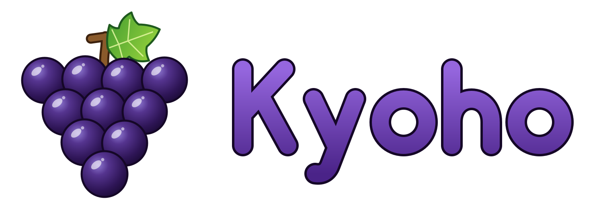

<!--
# SPDX-FileCopyrightText: Copyright 2026 Kyoho Emulator Project
# SPDX-License-Identifier: GPL-3.0-or-later

# SPDX-FileCopyrightText: Copyright 2025 Eden Emulator Project
# SPDX-License-Identifier: GPL-3.0-or-later

# SPDX-FileCopyrightText: 2018 yuzu Emulator Project
# SPDX-License-Identifier: GPL-2.0-or-later
-->
<!-- lang: en-GB -->

  

<h4 align="center">
  An experimental, open-source Nintendo Switch and Switch 2 emulator, built on Eden.
</h4>

  <a href="#what-kyoho-is">About</a> |
  <a href="#status">Status</a> |
  <a href="#downloads-and-setup">Downloads</a> |
  <a href="#building">Building</a> |
  <a href="#reporting-problems">Reporting problems</a> |
  <a href="#credits-and-license">Credits and license</a>

## What Kyoho is

Kyoho, named after the large dark grape, is a fork of [Eden](https://git.eden-emu.dev/eden-emu/eden) that adds Switch 2 support to it. It is written in C++, like the projects it comes from, and keeps everything Eden does for the original Switch.

It is an independent fork: not an official release of Eden, Eglantine or Lichii, and not affiliated with Nintendo.

### How it relates to Eglantine and Lichii

[Eglantine](https://github.com/Djihads80/Eglantine) and [Lichii](https://github.com/zortos293/Lichii) are the established Switch 2 forks of Eden. Both are further along, with wider game testing and communities behind them. If you only want to play, start there.

Kyoho began from Eden's own `master` rather than from either fork, and implements Switch 2 support separately:

- **A shader frontend written against hardware.** The Switch 2 GPU uses the same instruction family as NVIDIA's RTX 30 series, so the translator's instruction semantics are checked against test vectors generated on a real RTX card instead of being inferred from games. The tools are in [tools/ampere-sm86](tools/ampere-sm86).
- **The rest of the Switch 2 stack**: the GPU engine classes, kernel and service changes, the newer display and video-decoding services, and the NUP package format.
- **A split GPU thread**, which parses command lists on one thread and executes them on another.
- **Fixes ported from the other forks.** Many rendering and performance fixes come from Lichii, Fritchii, Eglantine and eden-fefw. Ported commits name the commit they came from.

Performance is measured against Lichii with the same settings on the same machine. On the games compared so far Kyoho is in the same range, not ahead.

### Development and AI assistance

This is one person's development branch made public. Most of the fork's own commits were written with an AI assistant (Claude) and say so in the commit message. The changes were tested by running the games, but nobody else has reviewed them.

## Status

Compatibility and performance vary by game, hardware and driver. Rendering errors, stutters and crashes are to be expected, and a game listed below can still break later on.

Everything here was tested on one Windows machine with an NVIDIA RTX 3090. Eden's Linux, macOS and Android builds are inherited, but this fork's changes have not been tested on them, and neither have AMD or Intel GPUs.

Switch 2 games that have been run during development, and how far they got when last checked:

| Game | Reached | Known problems |
| --- | --- | --- |
| The Legend of Zelda: Ocarina of Time | In game; the main test and benchmark game | Frame rate dips in heavy outdoor scenes |
| Splatoon Raiders | In game, 55–60 fps in the opening area | Frame rate sometimes settles around 45–50 fps |
| Mario Kart World | Races | Some rendering detail may be missing |
| Donkey Kong Bananza | In game | — |
| Hyrule Warriors: Age of Imprisonment | In game, 55–58 fps | — |
| Fast Fusion | Races, 38–44 fps | — |
| Star Fox | Title at 60 fps, training stage | Occasional blocky corruption |
| Fire Emblem: Fortune's Weave | Story dialogue | Not tested further |
| Pokémon Pokopia | Enters the 3D world | Not tested further |
| Yoshi demo | Title and intro movie | Not tested further |
| Nintendo Switch 2 Welcome Tour | Title | Not tested further |
| Mario Tennis Fever | Menus | Black ground in a menu scene |
| Minecraft | Does not render | The game brings its own Vulkan driver, which is not supported |

Frame rates are from the test machine and are not a promise for yours. Most entries were last checked in early November 2026; the first two are checked most often.

## Downloads and setup

There are no prebuilt releases yet. When there are, they will be on this repository's [releases page](../../releases). Until then, [build it](#building).

On Windows the emulator is **kyoho.exe**. Extract or build the whole folder and run it from there.

Games, keys and firmware are not included. Use only games and system files you dumped from your own console.

### Existing saves and settings

Kyoho keeps Eden's data folders and configuration keys (`%APPDATA%\eden` on Windows), as Eglantine and Lichii do. It does not move or delete anything, so an existing Eden, Eglantine or Lichii setup carries over.

That also means these emulators share saves, settings and shader caches when they are installed side by side, and their cache formats are not always compatible. Back up your saves and the `shader` folder before trying an experimental build.

## Building

See the [build guide](docs/Build.md). The [user handbook](docs/user/README.md) and the rest of the inherited documentation still say Eden in most places.

Some build target names are also inherited:

| Target | Output |
| --- | --- |
| `yuzu` | `kyoho` (`kyoho.exe` on Windows), the desktop application |
| `yuzu-cmd` | `eden-cli`, the command-line frontend |

## Reporting problems

Use this repository's [issue tracker](../../issues). A report is useful when it has:

- the build (the title bar shows it), the game and its version;
- your CPU, GPU and graphics driver version;
- the settings you changed, and the steps to reach the problem;
- a screenshot, and the log from that session, after checking it for personal information.

Do not upload games, keys, firmware or account information.

Please do not take problems with Kyoho to Eden's, Eglantine's or Lichii's developers. They do not maintain this fork.

To contribute, see [CONTRIBUTING.md](CONTRIBUTING.md).

## Artwork

The logo is original artwork for this project, drawn as SVG: [dist/branding](dist/branding). The Windows and macOS icons are generated from it by [tools/generate-kyoho-icons.py](tools/generate-kyoho-icons.py).

## Credits and license

Kyoho exists because of other people's work:

- [Eden](https://git.eden-emu.dev/eden-emu/eden), started by Camille LaVey, which Kyoho is a fork of, and yuzu and Sudachi before it;
- [Eglantine](https://github.com/Djihads80/Eglantine), an earlier Switch 2 fork of Eden, whose notes and code were a reference throughout;
- [Lichii](https://github.com/zortos293/Lichii) and [Fritchii](https://github.com/Frizti/Fritchii), which many of the rendering and performance fixes here were ported from;
- [eden-fefw](https://git.eden-emu.dev/Duck912/eden-fefw), for several CPU and shader compiler optimisations.

Their copyright notices and the third-party licenses are retained.

Kyoho is licensed under the GPLv3 (or any later version). See [LICENSE.txt](LICENSE.txt) and the notices in the source files.

"Nintendo Switch" is a trademark of Nintendo. Kyoho is not affiliated with Nintendo in any way.
